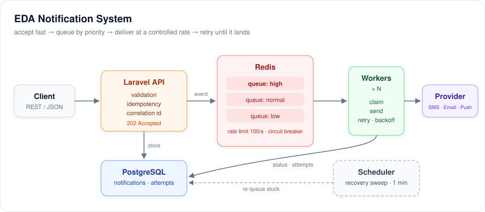

<div align="center">

# EDA Notification System

**Event-driven notification service for SMS, Email and Push, built with Laravel.**

[](https://github.com/eyupfidan/eda-notification-system/actions/workflows/ci.yml)




</div>

## Features

- **Async by design:** the API stores notifications and answers `202`. Queue workers deliver them.
- **Batches** of up to 1000 notifications, stored atomically (all or nothing).
- **Priority queues** (`high > normal > low`) and a strict **100 msg/s per channel** limit shared by all workers.
- **No duplicates:** `Idempotency-Key` support, atomic claiming of each delivery, idempotency key forwarded to the provider.
- **Smart retries:** exponential backoff with jitter, `Retry-After` support, a circuit breaker per channel,
  manual and batch retry, and a recovery sweep for anything stuck.
- **Observable:** correlation ids from request to provider, JSON logs, `/metrics` (JSON + Prometheus) and `/health`.

## Quick start

```bash
git clone https://github.com/eyupfidan/eda-notification-system.git
cd eda-notification-system
docker compose up -d --build
```

| | |
|---|---|
| API | http://localhost:8080/api/v1 |
| API docs (Swagger) | http://localhost:8080/docs/api · [`docs/openapi.json`](docs/openapi.json) |
| Health / Metrics | http://localhost:8080/health · http://localhost:8080/metrics |

**Provider.** Create a URL on [webhook.site](https://webhook.site) that answers `202` with
`{"messageId": "<uuid>", "status": "accepted", "timestamp": "<ISO8601>"}`, then run:

```bash
echo "NOTIFICATION_PROVIDER_URL=https://webhook.site/<your-uuid>" > .env && docker compose up -d
```

> [!NOTE]
> webhook.site's free plan accepts only ~50 requests per URL. For batches and load tests, run `make up-mock`
> to use the bundled mock provider (same contract, no quota, optional failure injection such as
> `MOCK_FAILURE_RATE=0.3`).

## API

| Method | Endpoint | |
|---|---|---|
| `POST` | `/api/v1/notifications` | Create one notification |
| `POST` | `/api/v1/notifications/batch` | Create up to 1000 notifications |
| `GET` | `/api/v1/notifications/{id}` | Status and delivery attempts |
| `GET` | `/api/v1/notifications` | Filter by `status`, `channel`, `priority`, `batch_id`, `from`, `to` (cursor pagination) |
| `PATCH` | `/api/v1/notifications/{id}/cancel` | Cancel before delivery starts |
| `POST` | `/api/v1/notifications/{id}/retry` | Retry a failed notification |
| `GET` · `PATCH` · `POST` | `/api/v1/batches/{id}` · `/cancel` · `/retry` | Batch status, cancel, retry |

```bash
curl -X POST http://localhost:8080/api/v1/notifications \
  -H 'Content-Type: application/json' -H 'Idempotency-Key: order-1042' \
  -d '{"channel":"sms","recipient":"+905551234567","content":"Your order has shipped","priority":"high"}'
```

Validation: SMS uses E.164 numbers and up to 1600 characters, Email needs an address and a `subject`, Push needs a
device token and up to 1000 characters. Errors share one format: `{"error": {"code", "message", "details"}}`.

## How it works

**Lifecycle:** `pending → queued → processing → sent`. A temporary failure goes back to `queued` with a retry time.
A permanent failure, or running out of attempts, ends in `failed`. `pending` and `queued` notifications can be cancelled.

| Provider response | Result |
|---|---|
| `2xx` + `messageId` | `sent` |
| timeout, `5xx`, `429` | retry after 10s → 30s → 90s → 270s (±20% jitter, max 5 attempts) |
| other `4xx` | `failed` right away, since retrying cannot help |

<details>
<summary><b>Key design decisions</b></summary>

- **Sliding-window rate limiter** (Redis sorted set + Lua): never more than 100 sends in *any* one-second span.
  A fixed window allowed 108 under load.
- **Atomic claim:** `UPDATE … WHERE status = 'queued'` before every send. Duplicate jobs, or jobs for notifications
  cancelled a moment earlier, never reach the provider.
- **Idempotency key in a unique column:** no TTL, and safe under races. 10 concurrent requests with the same key create 1 row.
- **Event after commit:** jobs are queued only for rows that are really saved.
  Bursts become queue depth, not API latency.
- **Circuit breaker:** 10 temporary failures in a row pause a channel for 30s without spending attempts.
- **Recovery sweep** (every minute, `FOR UPDATE SKIP LOCKED`): re-queues notifications stuck after crashes or Redis loss.
- **Cursor pagination:** costs the same on page 1 and page 10 000 of a table with millions of rows.

</details>

**Measured:** 1000 SMS with 8 workers in 19s, at most 100/s. With the mock failing 30% of calls, 300 notifications
were all delivered through retries.

## Observability

- `X-Correlation-ID` is accepted or generated, returned, stored on the notification and present in every log line and provider call.
- `GET /metrics?window=5m`: queue depth, status counts, success/failure rates, throughput, p50/p95/p99 latency, circuit state.
  Add `&format=prometheus` for Prometheus.
- `GET /health`: database, Redis, queue, workers and scheduler. Returns `503` if DB or Redis is down.

## Development

```bash
make test        # 136 tests (PostgreSQL + Redis, isolated test databases)
make coverage    # coverage summary
make up-mock     # run with the mock provider
make docs        # regenerate docs/openapi.json
make help        # all commands
```

CI runs lint, tests and a Docker Compose smoke test on every push. Settings such as
`NOTIFICATION_RATE_LIMIT_PER_SECOND`, `NOTIFICATION_MAX_ATTEMPTS` and `WORKER_REPLICAS` are listed in [`.env.example`](.env.example).
