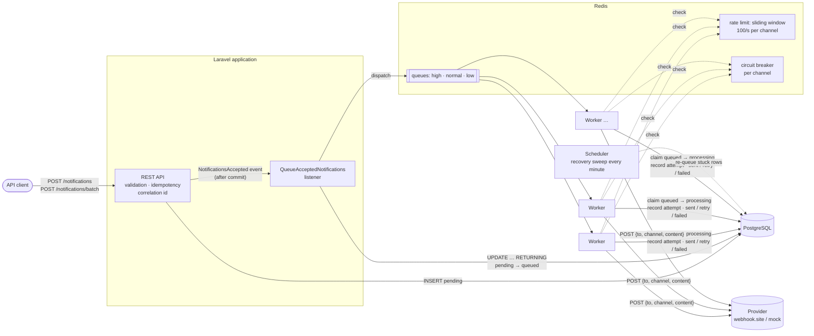
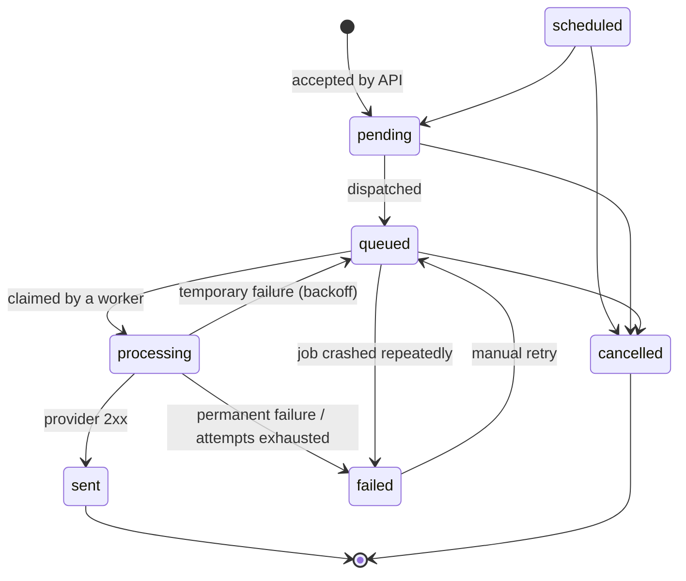

# EDA Notification System

[](https://github.com/eyupfidan/eda-notification-system/actions/workflows/ci.yml)

An event-driven notification service built with **Laravel 13**. It accepts SMS, Email and Push
notifications over a REST API, stores them in **PostgreSQL**, and delivers them asynchronously through
**Redis** priority queues to an external provider. Delivery is rate limited per channel, failed
deliveries are retried with exponential backoff, and every status change can be followed in real time.

- **Async by design:** the API stores the notification and answers `202 Accepted`. Queue workers do the delivery.
- **High throughput:** batches of up to 1000 notifications, priority queues (`high > normal > low`), and
  horizontal workers with a shared **100 msg/s per channel** limit.
- **Reliable:** idempotent API, exactly-once claiming of each delivery, retries with backoff + jitter,
  a circuit breaker, and a recovery sweep for anything stuck.
- **Observable:** correlation ids from request to provider, JSON logs, `/metrics` (JSON + Prometheus) and `/health`.

---

## Contents

- [Quick start](#quick-start)
- [Architecture](#architecture)
- [API](#api)
- [Design decisions](#design-decisions)
- [Observability](#observability)
- [Testing](#testing)
- [Configuration](#configuration)
- [Project structure](#project-structure)
- [Production notes and next steps](#production-notes-and-next-steps)

---

## Quick start

Requirements: Docker with Docker Compose v2. Nothing else (PHP, Composer, a database) is needed on the host.

```bash
git clone https://github.com/eyupfidan/eda-notification-system.git
cd eda-notification-system
docker compose up -d --build
```

That's it. Migrations run automatically.

| URL | What |
|---|---|
| http://localhost:8080/api/v1/notifications | REST API |
| http://localhost:8080/docs/api | Interactive API docs (Swagger / OpenAPI) |
| http://localhost:8080/health | Health check |
| http://localhost:8080/metrics | Real-time metrics |

### Connect the provider (webhook.site)

The external provider is simulated with [webhook.site](https://webhook.site):

1. Open https://webhook.site and copy your unique URL.
2. Click **Edit** and set **Default status code** `202`, **Content type** `application/json` and **Response body**
   `{"messageId": "3f2b8c1e-7a4d-4e9b-9c2a-1d5e6f7a8b9c", "status": "accepted", "timestamp": "2026-01-01T12:00:00Z"}`.
3. Start the stack with that URL:

```bash
echo "NOTIFICATION_PROVIDER_URL=https://webhook.site/<your-uuid>" > .env
docker compose up -d
```

> **webhook.site's free plan accepts only about 50 requests per URL.** After that it answers
> `429 Request limit exceeded` permanently. The service handles this correctly (temporary failure →
> backoff → circuit breaker → `failed` once attempts are exhausted → recoverable with `POST /batches/{id}/retry`),
> but for batches and load tests use the bundled mock provider:

```bash
make up-mock     # same stack, provider = local mock (no request quota)
make mock-stats  # what the mock received: totals per status/channel, peak requests per second
```

The mock has the same contract as the webhook.site setup and can inject failures:
`MOCK_FAILURE_RATE=0.3 MOCK_RATE_LIMIT_RATE=0.05 make up-mock` makes 30% of calls return `503` and 5% return `429`.

### Try it

```bash
curl -s -X POST http://localhost:8080/api/v1/notifications \
  -H 'Content-Type: application/json' -H 'Accept: application/json' \
  -H 'Idempotency-Key: order-1042-shipped' \
  -d '{"channel":"sms","recipient":"+905551234567","content":"Your order has shipped","priority":"high"}'
```

`make help` lists all shortcuts: `up`, `up-mock`, `down`, `logs`, `test`, `coverage`, `docs`, `shell` and more.

---

## Architecture



**Request path.** The API validates the payload, writes the notification(s) as `pending` inside a
transaction, and raises a `NotificationsAccepted` event that fires **only after the commit**. A listener
flips the rows to `queued` with a single `UPDATE … RETURNING` and pushes one job per notification onto the
queue matching its priority. The API never calls the provider, so its latency does not depend on the provider.

**Delivery path.** Workers drain `high` before `normal` before `low`. Each job passes the circuit breaker
and the per-channel rate limiter, **claims** the notification with an atomic `queued → processing` update,
calls the provider, records the attempt, and moves the notification to `sent`, back to `queued` (retry with
backoff), or to `failed`.

### Notification lifecycle



Transitions are enforced in one place ([`Status`](app/Enums/Status.php)). The database also rejects unknown
channel, priority and status values through `CHECK` constraints.

---

## API

Full, interactive reference: **http://localhost:8080/docs/api**. The OpenAPI 3.1 spec is committed at
[`docs/openapi.json`](docs/openapi.json) (regenerate with `make docs`).

| Method | Endpoint | Description |
|---|---|---|
| `POST` | `/api/v1/notifications` | Create a notification → `202` |
| `POST` | `/api/v1/notifications/batch` | Create up to 1000 notifications atomically → `202` |
| `GET` | `/api/v1/notifications/{id}` | Status, timestamps and every delivery attempt |
| `GET` | `/api/v1/notifications` | List with filters (`status`, `channel`, `priority`, `batch_id`, `from`, `to`) and cursor pagination |
| `PATCH` | `/api/v1/notifications/{id}/cancel` | Cancel if not yet being delivered (`409` otherwise) |
| `POST` | `/api/v1/notifications/{id}/retry` | Re-queue a `failed` notification with a fresh attempt budget |
| `GET` | `/api/v1/batches/{batchId}` | Number of notifications per status |
| `PATCH` | `/api/v1/batches/{batchId}/cancel` | Cancel everything in the batch that is still cancellable |
| `POST` | `/api/v1/batches/{batchId}/retry` | Re-queue every failed notification of the batch |
| `GET` | `/health` | Dependency health (`503` when DB or Redis is down) |
| `GET` | `/metrics` | Queue depth, rates, latency, circuit state (`?format=prometheus`) |

### Content validation

| Channel | Recipient | Content | Other |
|---|---|---|---|
| `sms` | E.164 phone number (`+905551234567`) | ≤ 1600 characters (10 concatenated segments) | |
| `email` | valid email address | ≤ 100 000 characters | `subject` required (≤ 255) |
| `push` | device token, 16–320 chars `[A-Za-z0-9:_-.]` | ≤ 1000 characters | `subject` used as title |

Limits are counted in characters, not bytes (`ş` counts as one). `priority` is `high`, `normal` (default) or `low`.
`metadata` is an optional JSON object.

### Examples

<details>
<summary><b>Create a notification</b></summary>

```bash
curl -s -X POST http://localhost:8080/api/v1/notifications \
  -H 'Content-Type: application/json' -H 'Accept: application/json' \
  -H 'Idempotency-Key: welcome-jane' -H 'X-Correlation-ID: signup-flow-17' \
  -d '{"channel":"email","recipient":"jane@example.com","subject":"Welcome","content":"Hi Jane!"}'
```

```http
HTTP/1.1 202 Accepted
Location: http://localhost:8080/api/v1/notifications/01a2196a-bcfa-7ef9-a278-ce2f9ea3836b
Idempotent-Replayed: false
X-Correlation-ID: signup-flow-17
```

```json
{
  "data": {
    "id": "01a2196a-bcfa-7ef9-a278-ce2f9ea3836b",
    "batch_id": null,
    "correlation_id": "signup-flow-17",
    "channel": "email",
    "recipient": "jane@example.com",
    "subject": "Welcome",
    "content": "Hi Jane!",
    "priority": "normal",
    "status": "queued",
    "attempts": 0,
    "max_attempts": 5,
    "next_retry_at": null,
    "...": "..."
  }
}
```

Sending the same request again with the same `Idempotency-Key` returns `200` with `Idempotent-Replayed: true`
and the same notification. Using the key with a different payload returns `422 idempotency_key_reused`.
</details>

<details>
<summary><b>Create a batch</b></summary>

```bash
curl -s -X POST http://localhost:8080/api/v1/notifications/batch \
  -H 'Content-Type: application/json' -H 'Accept: application/json' \
  -d '{"notifications":[
        {"channel":"sms","recipient":"+905551234567","content":"Flash sale starts now!","priority":"high"},
        {"channel":"push","recipient":"fcm-token-0123456789abcdef","subject":"Flash sale","content":"50% off for 1 hour"}
      ]}'
```

```json
{
  "data": {
    "batch_id": "01a21962-e9fc-7de7-a560-77a876c35630",
    "total": 2,
    "notifications": [
      {"id": "01a21962-...", "channel": "sms", "recipient": "+905551234567", "priority": "high", "status": "pending"},
      {"id": "01a21962-...", "channel": "push", "recipient": "fcm-token-0123456789abcdef", "priority": "normal", "status": "pending"}
    ]
  }
}
```

If any item is invalid, nothing is stored and the errors point at the item: `notifications.1.recipient`.
</details>

<details>
<summary><b>Track, list, cancel, retry</b></summary>

```bash
# One notification with its delivery attempts (outcome, HTTP status, duration, error)
curl -s http://localhost:8080/api/v1/notifications/{id} -H 'Accept: application/json'

# Batch progress
curl -s http://localhost:8080/api/v1/batches/{batchId} -H 'Accept: application/json'
# {"data":{"batch_id":"…","total":1000,"statuses":{"pending":0,"queued":412,"processing":8,"sent":580,"failed":0,"cancelled":0,"scheduled":0}}}

# Failed SMS of the last day, 50 per page (follow meta.next_cursor / links.next)
curl -s 'http://localhost:8080/api/v1/notifications?status=failed&channel=sms&from=2026-11-25&to=2026-11-26&per_page=50' \
  -H 'Accept: application/json'

# Cancel / retry
curl -s -X PATCH http://localhost:8080/api/v1/notifications/{id}/cancel -H 'Accept: application/json'
curl -s -X POST  http://localhost:8080/api/v1/batches/{batchId}/retry   -H 'Accept: application/json'
```
</details>

### Errors

All errors share one envelope:

```json
{"error": {"code": "validation_failed", "message": "The given data was invalid.",
           "details": {"recipient": ["The recipient must be a phone number in E.164 format (e.g. +905551234567)."]}}}
```

| Status | `code` | When |
|---|---|---|
| 400 | `invalid_idempotency_key` | Malformed `Idempotency-Key` header |
| 404 | `not_found` | Unknown notification or batch |
| 409 | `invalid_status_transition` | Cancel after delivery started, retry of a non-failed notification |
| 422 | `validation_failed` | Invalid payload or query parameters |
| 422 | `idempotency_key_reused` | Same key, different payload |

---

## Design decisions

### Asynchronous processing and the event

Creating a notification only writes to the database. The `NotificationsAccepted` event implements
`ShouldDispatchAfterCommit`, so jobs are never queued for rows that could still be rolled back.
A burst of traffic (flash sale, breaking news) turns into queue depth instead of API latency:
the API stays fast and workers drain the backlog at the allowed rate.

A batch of 1000 is validated as a whole, then stored with a few multi-row `INSERT`s in **one transaction**
(all or nothing). This takes about 0.4 s end to end.

### Priority queues

Each priority has its own Redis queue. Workers run `queue:work --queue=high,normal,low`, so they always
take from `high` first and `low` only when the others are empty. Verified live: a `low` notification
created before a batch of `normal` ones was delivered after all of them.

### Rate limiting: 100 messages per second per channel

The limit has to hold across **all** workers, so it lives in Redis. A fixed window (`Redis::throttle`)
was not enough. A window does not start on a second boundary, so two windows can fall into the same
second: under load I measured **108 sends in one calendar second**.

The limiter is now a **sliding window** ([`SlidingWindowRateLimiter`](app/Services/Delivery/SlidingWindowRateLimiter.php)):
a Redis sorted set of the last second's sends, checked and updated by one atomic Lua script that
uses Redis' own clock, so workers cannot disagree about time. A job over the limit is **released** back to
its queue (not failed) and keeps its status and attempt budget. Measured with 8 workers and 1000 SMS:
**at most 100 sends in any one-second span**, 1000 sent in 19 s.

### Idempotency: no duplicate sends

Duplicates are prevented at three levels:

1. **API:** `Idempotency-Key` is stored in a **unique column** (no TTL, survives restarts). Replays get the
   original result. When two requests with the same key race past the pre-check, the loser hits the unique
   constraint and returns the winner's notification. Verified with 10 concurrent requests → 1 row.
2. **Worker:** a job may run twice (queue redelivery, recovery sweep). Before calling the provider it
   **claims** the row with `UPDATE … SET status='processing' WHERE id=? AND status='queued'`. Only one claim
   can succeed, so a duplicate job, or a job for a notification cancelled a moment earlier, exits without sending.
3. **Provider:** each call carries `Idempotency-Key: <notification id>`, so a resend after an unknown outcome
   (a worker crashed mid-call) can be de-duplicated on the provider's side.

### Delivery and retry logic

The case leaves this part open. These are the rules I chose:

| Provider outcome | Classification | What happens |
|---|---|---|
| `2xx` with `messageId` | success | `sent`, `provider_message_id` stored |
| timeout / connection error, `5xx`, `429` | **temporary** | retry with backoff (respecting `Retry-After`), counts toward the circuit breaker |
| other `4xx` | **permanent** | `failed` immediately, retrying cannot help |
| `2xx` without `messageId` | **permanent** | `failed`, not retried because it may already have been delivered |

- **Backoff:** `10s → 30s → 90s → 270s …` (×3, capped at 15 min) with **±20% jitter**. Without jitter, thousands of
  notifications that failed together would all retry in the same second and cause a second spike.
  The delay is never shorter than the provider's `Retry-After`.
- **While waiting:** the notification is `queued` with `next_retry_at`, and the job releases itself with that
  delay. Retries do not consume queue `tries`, because attempts are counted on the notification itself.
- **Attempts:** at most 5 (configurable). Every attempt is stored in `notification_attempts` (outcome, HTTP status,
  duration, error) and returned by `GET /notifications/{id}`.
- **Manual retry:** `POST /notifications/{id}/retry` or `/batches/{id}/retry` re-queues `failed` notifications
  with a fresh budget, for example after a provider outage.
- **Circuit breaker (per channel, in Redis):** after 10 consecutive temporary failures the channel pauses for 30 s.
  Jobs are released without spending attempts instead of hammering a provider that is down. When the
  cooldown ends, one success closes the circuit and one more failure reopens it immediately (half-open).
- **Recovery sweep:** `notifications:recover` runs every minute (`withoutOverlapping`, `onOneServer`) and re-queues rows
  stuck after something outside the happy path broke: `pending` for over 1 min (Redis was down when the event fired),
  `processing` for over 2 min (worker crashed), `queued` for over 15 min (job lost). It uses `FOR UPDATE SKIP LOCKED`, so
  overlapping sweeps never touch the same row. Thanks to the atomic claim, a re-pushed duplicate job is harmless.
- **Unexpected errors** (a bug or a DB hiccup, not a provider verdict) put the notification back to `queued`. The job
  is retried 3 times and then marked `failed` with the error.

**Live outage test:** with the provider made unreachable, 5 SMS were retried with growing delays and the circuit
opened after 3 failures (the 5th notification waited without spending an attempt). When the provider came back,
**all 5 were delivered automatically**. With the mock returning 30% `503` and 5% `429`, 300 mixed notifications ended
with 298 sent and 2 failed after 5 attempts (≈0.35⁵ expected). A batch retry then brought it to 300/300.

### Cursor pagination

The list endpoint uses cursor (keyset) pagination on `(created_at, id)`. On a table that grows by millions of rows
per day, `OFFSET` scans and `COUNT(*)` get slower with every page. A cursor costs the same on page 1 and page 10 000.
Filters match the composite index `(status, channel, created_at)`.

### Other choices

- **UUIDv7 primary keys:** time-ordered, so inserts stay index-friendly and ids are safe to expose.
- **PostgreSQL:** `UPDATE … RETURNING`, `FOR UPDATE SKIP LOCKED`, `jsonb`, partial indexes and `percentile_cont`
  for latency percentiles are all used directly.
- **Redis with AOF persistence:** queued jobs survive a Redis restart. The recovery sweep covers the rest.
- **No message broker:** Redis queues + Laravel's queue system cover the requirements with less moving parts.
  The provider and queue are behind interfaces, so moving to RabbitMQ/Kafka is a configuration and adapter change
  (see [Production notes](#production-notes-and-next-steps)).

---

## Observability

### Correlation ids and structured logs

Every request gets an `X-Correlation-ID`. Yours is used when it is well formed; otherwise a UUIDv7 is generated.
It is returned in the response, stored on the notification and put into Laravel's `Context`, so **every log
line**, including the worker that delivers the notification hours later after retries, carries it.
It is also forwarded to the provider. Logs are JSON on stderr:

```json
{"message":"Notification sent","level_name":"INFO",
 "context":{"notification_id":"01a21986-…","channel":"email","attempt":1,"provider_message_id":"4a118d41-…","duration_ms":53},
 "extra":{"correlation_id":"signup-flow-17","notification_id":"01a21986-…","channel":"email"}}
```

```bash
docker compose logs worker | grep signup-flow-17
```

### `GET /metrics`

`?window=1m|5m|15m|1h|24h` (default `5m`), `?format=prometheus` for Prometheus scraping.

- **Queue depth** per priority: `ready`, `delayed` (backoff / rate-limit releases), `reserved` (in progress)
- **Notifications per status**
- **Delivery** per channel in the window: sent, failed, success/failure rate, throughput, end-to-end latency (accepted → sent) avg/p50/p95/p99
- **Provider attempts** per channel: success / retryable / permanent, provider latency avg/p50/p95/p99
- **Circuit breaker** state per channel, **active workers**, configured rate limit

### `GET /health`

Checks the database, Redis, the queue, worker heartbeats and the scheduler.

| `status` | HTTP | Meaning |
|---|---|---|
| `ok` | 200 | Everything is running |
| `degraded` | 200 | API works but delivery is impaired (no worker heartbeat, scheduler not running) |
| `down` | 503 | Database or Redis unreachable, so notifications cannot be accepted |

Right after startup `/health` reports `degraded` for up to a minute: the scheduler beats once per minute and has not run yet.
Laravel's built-in `/up` remains available as a plain liveness probe.

---

## Testing

```bash
make test       # 136 tests against PostgreSQL + Redis inside the container
make coverage   # same, with a coverage summary (99.5% of lines)
```

**CI** ([`.github/workflows/ci.yml`](.github/workflows/ci.yml)) runs on every push and pull request:
Pint lint, the full test suite with coverage against PostgreSQL 18 and Redis 7 service containers, and a
Docker Compose smoke test that starts the stack exactly as described in [Quick start](#quick-start) and checks that a
notification is delivered end to end.

Tests run against a dedicated `notifications_test` database and Redis database `15`, never the application's data.
The base test case refuses to run otherwise and flushes the test Redis database before each test.

Covered areas:

- validation per channel
- batch limits (1000 accepted, 1001 rejected, all-or-nothing)
- idempotency, including a **real race** where a competing request commits the same key through a second DB connection
- cancel rules and concurrent cancels
- filtering and cursor pagination
- job outcomes for every provider response class
- backoff and `Retry-After`, max attempts
- duplicate and cancelled jobs never reaching the provider
- sliding-window rate limiting
- circuit breaker
- recovery sweep, manual retry
- correlation id propagation
- metrics (JSON and Prometheus)
- health with DB/Redis deliberately broken

---

## Configuration

Everything works with the defaults. Override in `.env` (see [`.env.example`](.env.example)) or in the environment.

| Variable | Default | Description |
|---|---|---|
| `NOTIFICATION_PROVIDER_URL` | none | Provider endpoint (your webhook.site URL; `make up-mock` sets the mock) |
| `NOTIFICATION_RATE_LIMIT_PER_SECOND` | `100` | Max provider calls per second, per channel, across all workers |
| `NOTIFICATION_MAX_ATTEMPTS` | `5` | Delivery attempts before `failed` |
| `NOTIFICATION_RETRY_BASE_DELAY` | `10` | First retry delay in seconds (then ×3, capped at 900) |
| `NOTIFICATION_CB_THRESHOLD` / `_COOLDOWN` | `10` / `30` | Circuit breaker: consecutive failures / pause in seconds |
| `WORKER_REPLICAS` | `2` | Number of queue worker containers |
| `APP_PORT` / `DB_FORWARD_PORT` | `8080` / `54320` | Host ports for the API and PostgreSQL |
| `MOCK_FAILURE_RATE` / `MOCK_RATE_LIMIT_RATE` / `MOCK_TIMEOUT_RATE` | `0` | Mock provider failure injection (0–1) |

`docker-compose.yml` contains a fixed `APP_KEY` so the stack starts without any setup. It is meant for
local use only; always set your own `APP_KEY` elsewhere.

---

## Project structure

```
app/
├── Console/Commands/RecoverStuckNotifications.php   # recovery sweep (scheduled every minute)
├── Enums/                                           # Channel, Priority, Status (state machine), AttemptOutcome
├── Events/NotificationsAccepted.php                 # raised after commit
├── Http/
│   ├── Controllers/Api/V1/                          # NotificationController, BatchController
│   ├── Controllers/ObservabilityController.php      # /metrics, /health
│   ├── Middleware/                                  # AssignCorrelationId, ValidateIdempotencyKey
│   ├── Requests/ · Resources/
├── Jobs/SendNotificationJob.php                     # claim → send → sent / retry / failed
├── Jobs/Middleware/                                 # SkipWhenCircuitOpen, RateLimitPerChannel
├── Listeners/                                       # QueueAcceptedNotifications, RecordWorkerHeartbeat
├── Models/                                          # Notification (compare-and-set transitions), NotificationAttempt
├── Providers/Notifications/                         # NotificationProvider contract, WebhookSiteProvider
├── Rules/                                           # per-channel recipient and content rules
└── Services/
    ├── NotificationService.php                      # create, batch, idempotency, cancel, retry, list
    ├── NotificationDispatcher.php                   # every transition into "queued"
    ├── Delivery/                                    # RetryPolicy, CircuitBreaker, SlidingWindowRateLimiter
    └── Observability/                               # MetricsCollector, PrometheusFormatter, HealthChecker, Heartbeats
docker/                                              # PHP-FPM image, nginx, Postgres init, mock provider
docs/openapi.json                                    # OpenAPI 3.1 spec
```

---

## Production notes and next steps

Things I would add before running this with real traffic, roughly in priority order:

- **Authentication and multi-tenancy:** API keys or OAuth per client, and scoping idempotency keys and listings per tenant.
- **Real provider adapters:** one `NotificationProvider` per channel (e.g. an SMS gateway, SES, FCM/APNs) selected by channel.
  The contract and error classification already allow this.
- **Data lifecycle:** partition `notifications` / `notification_attempts` by month and archive old partitions.
  Delivered notifications are append-mostly and grow by millions of rows a day.
- **Broker at larger scale:** Redis queues are simple and fast. At higher volume or with several consuming services,
  Kafka or RabbitMQ (dead-letter exchanges, replay, consumer groups) would replace them behind the same job and dispatcher.
- **Autoscaling workers** on queue depth (already exposed in `/metrics`), plus alerting on circuit state, failure rate and `degraded` health.
- **Bonus features** from the brief that are not implemented yet: scheduled notifications (the `scheduled` status,
  `scheduled_at` column and index are in place), templates, WebSocket status updates, distributed tracing (OpenTelemetry), CI pipeline.
