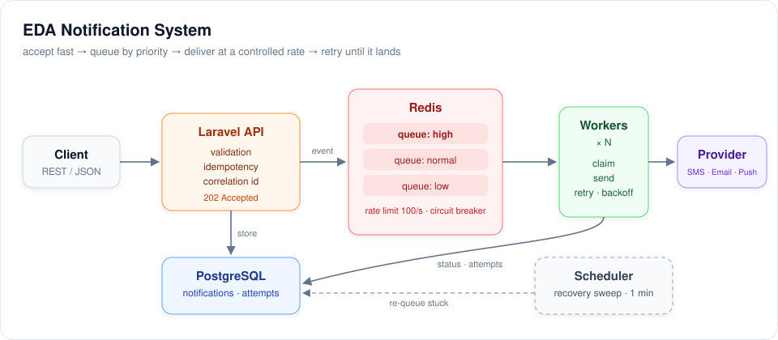

# Architecture

How the service is built and why. Companion to [`AGENTS.md`](../AGENTS.md) (rules and code map) and
the user-facing [`README.md`](../README.md). Keep this file in sync with the code (see `AGENTS.md`).



## Runtime (docker compose)

| Service | Image / command | Role |
|---|---|---|
| `app` | PHP 8.4-FPM (`docker/php/Dockerfile`) | Laravel API; runs migrations on start |
| `nginx` | nginx 1.27, host port `8080` | Front controller for `app`; resolves `app` via Docker DNS per request, so recreating `app` never leaves a stale IP |
| `worker` ×`WORKER_REPLICAS` | `queue:work redis --queue=high,normal,low` | Delivers notifications |
| `scheduler` | `schedule:work` | `notifications:dispatch-scheduled` every 10 s, `notifications:recover` every minute |
| `reverb` | `reverb:start`, host port `8085` | WebSocket server (Pusher protocol) |
| `postgres` | PostgreSQL 18, host port `54320` | Source of truth; `notifications_test` DB created by `docker/postgres/init-test-db.sh` |
| `redis` | Redis 7 with AOF | Queues, rate limiter, circuit breaker, heartbeats, cache |
| `mock-provider` (profile `mock`) | `php -S` on `docker/mock-provider/server.php`, host port `8090` | Provider stand-in with failure injection |

All PHP containers share one image and the `x-app` environment block in `docker-compose.yml`.

## Data model

**`notifications`** (UUIDv7 primary key)

| Column | Notes |
|---|---|
| `batch_id` | Shared by all items of a batch request |
| `template_id` → `templates.id` | `nullOnDelete`; `template_variables` jsonb keeps the values used |
| `idempotency_key` | **Unique.** Single: the header value; batch item: `{key}#{index}` |
| `correlation_id` | From `X-Correlation-ID`; restored by jobs for logging |
| `channel`, `priority`, `status` | Enums with PostgreSQL `CHECK` constraints |
| `recipient`, `subject`, `content`, `metadata` (jsonb) | `content` is stored rendered (templates resolved at creation) |
| `attempts`, `attempt_limit` | Attempts made; per-notification override of max attempts (set by manual retry) |
| `provider_message_id`, `last_error`, `next_retry_at` | Delivery bookkeeping |
| `scheduled_at`, `queued_at`, `sent_at`, `failed_at`, `cancelled_at` | Lifecycle timestamps (UTC, `timestamptz`) |

Indexes: `(status, channel, created_at)`, `created_at`, `batch_id`, `(status, scheduled_at)`,
`(status, updated_at)`, partial `sent_at` / `failed_at` (metrics windows).

**`notification_attempts`**: one row per provider call (`attempt`, `outcome`
success/retryable_failure/permanent_failure, `http_status`, `duration_ms`, `provider_message_id`,
`error`). Unique `(notification_id, attempt)`; index `(created_at, outcome)`.

**`templates`**: `name` (unique slug), `channel`, `subject`, `content` with `{{ variable }}` placeholders.

**`failed_jobs`** (Laravel): jobs that exhausted `maxExceptions`.

## Notification lifecycle

```
(scheduled) → pending → queued → processing → sent
                 │         │          ├──→ queued   temporary failure, next_retry_at set
                 │         │          └──→ failed   permanent failure / attempts exhausted
                 └─────────┴──→ cancelled (also from scheduled)
queued → failed    job crashed repeatedly (failed())
failed → queued    manual retry (fresh attempt budget)
```

Defined in `App\Enums\Status::allowedTransitions()`. `Notification::transitionIfStatus()` performs
`UPDATE … WHERE id = ? AND status IN (…)` and only succeeds for one concurrent caller.

## Flows

### Create (single / batch)

1. `AssignCorrelationId` puts the correlation id in `Context`.
2. FormRequest validation; second pass in `NotificationPayloadResolver` renders templates and checks
   the final text (email subject, per-channel length). Batch errors are keyed `notifications.{i}.field`.
3. `NotificationService::create()` / `createBatch()` replays when the `Idempotency-Key` exists (payload
   must match, else 422); otherwise inserts in one transaction (`pending`, or `scheduled` when
   `scheduled_at` is in the future). A unique-violation race returns the winner's result.
4. `NotificationsAccepted` (`ShouldDispatchAfterCommit`) → `QueueAcceptedNotifications` →
   `NotificationDispatcher::queuePending()` flips `pending → queued` with `UPDATE … RETURNING` and pushes
   `SendNotificationJob` onto the queue named after the priority.

### Delivery (`SendNotificationJob`)

Job middleware: `SkipWhenCircuitOpen` → `RateLimitPerChannel`. Both **release** the job (no attempt spent).

1. Restore `correlation_id`, `notification_id`, `channel` into `Context`.
2. Claim `queued → processing` (and `attempts + 1`). Lost claim → exit without sending.
3. `NotificationProvider::send()` (POST `{to, channel, content}`, headers `Idempotency-Key: <id>`,
   `X-Correlation-ID`).
4. Record a `notification_attempts` row, then:
   - success → `sent`, circuit breaker success;
   - `RetryableProviderException` with budget left → `queued` + `next_retry_at`, `release(delay)`;
   - otherwise → `failed`.
5. Unexpected exceptions: back to `queued`, rethrow; after `maxExceptions` (3) `failed()` marks it `failed`.

### Retry policy (`RetryPolicy`)

Delay before attempt *n+1* = `min(900, 10 × 3^(n-1))` × (1 ± 0.2 jitter), never below `Retry-After`.
Max attempts 5 (or `attempt_limit`). Only temporary failures retry.

### Rate limiting (`SlidingWindowRateLimiter`)

Redis sorted set per channel, checked and updated by one Lua script using Redis `TIME`: at most
`NOTIFICATION_RATE_LIMIT_PER_SECOND` (100) entries in any 1000 ms span. Over the limit → release
until the oldest entry expires.

### Circuit breaker (`CircuitBreaker`)

Per channel: consecutive temporary failures counted in Redis (window 60 s). At 10 the channel opens
for 30 s; jobs are released untouched. After the cooldown one success resets the counter, one failure
reopens immediately.

### Scheduled notifications

Stored as `scheduled`. `notifications:dispatch-scheduled` (every 10 s, `withoutOverlapping`,
`onOneServer`) calls `NotificationDispatcher::queueDueScheduled()` in chunks of 1000 with
`FOR UPDATE SKIP LOCKED` until nothing is due.

### Recovery (`notifications:recover`, every minute)

Re-queues rows stuck after failures outside the happy path: `pending` > 60 s (event lost),
`processing` > 120 s (worker died), `queued` with `COALESCE(next_retry_at, queued_at)` > 900 s ago
(job lost). Chunks of 1000 with `SKIP LOCKED`. Duplicate jobs are harmless thanks to the claim.
Also records the scheduler heartbeat.

### Real-time updates

`Notification::transitionTo()` / `transitionIfStatus()` call `StatusBroadcaster::statusChanged()` →
`NotificationStatusChanged` (`ShouldBroadcastNow`, payload captured at creation) on public channels
`notifications.{id}` and `batches.{batchId}`, event `notification.status`. Batch cancel/retry send
`BatchUpdated` (`batch.updated`). Broadcast errors are logged and swallowed. Bulk transitions done in
SQL by the dispatcher (pending → queued, scheduled → queued, batch cancel) do not emit per-row events.

## API surface

`/api/v1/notifications` (GET list, POST create), `/api/v1/notifications/batch` (POST),
`/api/v1/notifications/{id}` (GET), `/cancel` (PATCH), `/retry` (POST),
`/api/v1/batches/{id}` (GET), `/cancel` (PATCH), `/retry` (POST),
`/api/v1/templates` (CRUD), `/api/v1/templates/{id}/preview` (POST),
`/health`, `/metrics`, `/realtime` (demo page), `/docs/api` (Swagger UI), `/up`.
Spec: `docs/openapi.json` (generated by Scramble, `make docs`).

## Redis

| Key / structure | Used by |
|---|---|
| `queues:{high,normal,low}` (+ `:delayed`, `:reserved`) | Laravel Redis queue |
| `notifications:rate-limit:{channel}` (zset) | `RateLimitPerChannel` / `SlidingWindowRateLimiter` |
| `notifications:circuit:{channel}:failures` / `:open` | `CircuitBreaker` |
| `notifications:heartbeat:workers` (zset), `notifications:heartbeat:scheduler` | `Heartbeats` |
| cache / locks (`withoutOverlapping`, `onOneServer`) | Laravel cache store `redis` |

All keys carry Laravel's Redis prefix. Tests use Redis DB 15.

## Observability

- **Logs:** JSON on stderr; `Context` adds `correlation_id` (and in jobs `notification_id`, `channel`)
  to `extra` of every record.
- **`/metrics`** (`MetricsCollector`): queue depth (ready/delayed/reserved), status counts, delivery
  (sent/failed, rates, throughput, accepted→sent latency p50/p95/p99) and provider attempts per channel
  for a window (`1m|5m|15m|1h|24h`), circuit state, active workers. `?format=prometheus`.
- **`/health`** (`HealthChecker`): DB, Redis, queue, worker heartbeats (`Looping` event), scheduler
  heartbeat. DB/Redis down → 503 `down`; no worker / stale scheduler → 200 `degraded`.

## Configuration

`config/notifications.php`: `batch_max`, pagination, `rate_limit.per_second`, `retry.*`,
`circuit_breaker.*`, `recovery.*`, `realtime.public_port`, `provider.url|timeout`. Environment variables
are listed in `.env.example`; `docker-compose.yml` provides working defaults (including local-only
`APP_KEY` and Reverb credentials).

## Key decisions

| Decision | Why |
|---|---|
| Redis queues instead of a broker | Enough for the requirements, fewer moving parts; dispatcher and job are the seams for RabbitMQ/Kafka later |
| Idempotency in a unique DB column | No TTL, survives restarts, race-safe via the constraint |
| Atomic claim before every send | Makes at-least-once queues effectively exactly-once towards the provider |
| Sliding-window limiter in Lua | Fixed windows allowed up to 108/s under load |
| Scheduling in the database | Cancellable, survives Redis loss, no queue memory while waiting |
| Cursor pagination | Constant cost on large tables |
| Templates rendered at creation | Accepted messages never change when a template is edited |
| Broadcast payload captured at event creation | Each broadcast describes its own transition |
